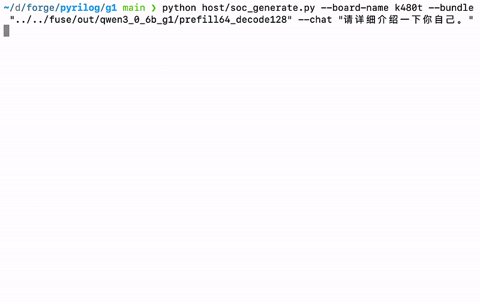
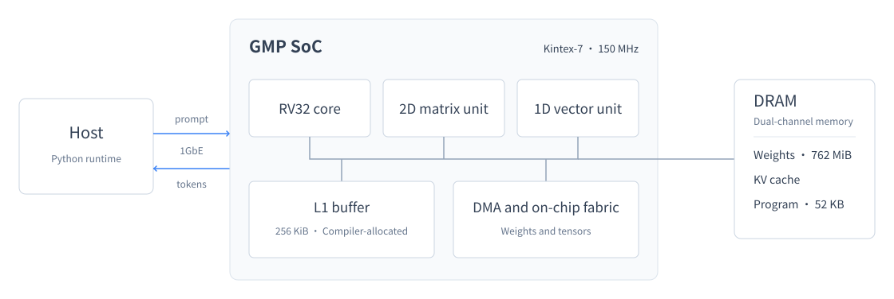

<div align="center">

<h1>GMP</h1>
<p><strong>An AI Native end-to-end LLM inference chip</strong></p>
<p>Single Kintex-7 FPGA · Qwen3-0.6B · All 28 layers</p>

<p>
  
  
  
</p>

<p><a href="README.md">中文</a> · <a href="#g1-architecture">G1 Architecture</a> · <a href="#quick-start">Quick start</a> · <a href="docs/bitstream.md">Measurements</a></p>

</div>

- **A complete model on the FPGA.** All 28 layers of prefill and autoregressive decode execute on the FPGA. The host handles tokenization, transfer and output display.
- **A stack implemented by agents.** One month, three repositories and 541 commits, from model compiler and cycle model to RTL and host drivers, with no human-written code.
- **Hardware generated from Python.** 36k lines of Pyrilog generate 126k lines of Verilog across 278 modules.

<p align="center">
  
</p>
<p align="center"><a href="docs/usage.md">On-board transcript</a> · <a href="docs/bitstream.md">Timing and resources</a> · <a href="demo/board_front_back.jpg">Board photos</a></p>

## G1 Architecture

GMP is a custom neural-network accelerator SoC for on-device inference, deployed on a Kintex-7 `xc7k480t` with weights
in on-board dual-channel DDR3. A compiler turns the whole network into a program executed by an on-chip RV32 controller,
with matrix and vector units performing the computation. The host communicates with the chip over 1GbE.



The compiler and hardware are designed together. On-chip buffer capacity and instruction latency are fully visible
to the compiler, which determines the schedule ahead of time. The program image for both prefill and decode totals **52 KB**.
Tiled weights and DRAM-row-aware access reduce the bytes read per decode step **from 1,114 MB to 662 MB**.

The configuration supports a 128-token context. Decode throughput is measured on the board; prefill time is calculated
from cycle count at 150 MHz. See the [measurement report](docs/bitstream.md) for hardware specifications, resources and timing.

## Development with agents

People set the top-level architecture and abstractions, and choose between design options. General-purpose AI agents participate
in microarchitecture, pipeline and operator-lowering discussions, then implement the code at every layer. Development spans
the model compiler, operator references, cycle-accurate C++ model, RTL, synthesis and place-and-route flow, and host drivers.
The CPU core, accelerator ISA and toolchain are developed in-house; FPGA integration uses DDR3 controllers, clocking primitives
and a third-party Ethernet MAC.

**Pyrilog** describes hardware in Python and emits Verilog through a deterministic generator. One class represents one module,
sequential logic lives in a `cycle` method, and clock and reset are connected automatically. Identical inputs produce byte-identical
RTL, while the generator checks for invalid signal references.

**The cycle modeling framework** uses C++ coroutines to simulate each chip unit, run the complete network and evaluate new hardware
before RTL implementation. It exposes statistics as JSON for agents to analyze. The compiler, cycle model and RTL share reference
data and automated checks. Layered documents preserve design intent, and dedicated skills guide writing and collaboration.

## Quick start

**FPGA:** follow [setup](docs/setup.md) to prepare the specified board, a Linux host, a direct 1GbE connection and a JTAG cable.
Once dependencies and permissions are configured, run:

```bash
python host/soc_generate.py --chat "请用一句话介绍一下你自己。"
```

The script programs the bitstream and loads weights as needed, then starts generation. The first run takes about a minute.
Programming uses the included pyjtag stack and needs no Vivado. See the [usage guide](docs/usage.md) for the full workflow and troubleshooting.

**Whole-SoC simulation:** on Linux x86-64 with Python 3.9 or later and NumPy, use the prebuilt Verilator simulator:

```bash
pip install numpy
python host/soc_generate.py --sim --chat "请用一句话介绍一下你自己。"
```

Simulation executes the whole SoC RTL and is substantially slower than the board. See the [simulation guide](docs/simulation.md)
for memory and runtime requirements. The guides under `docs/` are in Chinese.

The repository includes:

- [Inference artifacts](prebuilt/) and [model data](data/): bitstream, whole-SoC simulator, Qwen3-0.6B fixed-point weights, boot image and tokenizer vocabulary.
- [Host tools](host/) and [JTAG stack](tools/pyjtag/): source for the inference runtime, Ethernet communication and programming tools.
- [Standalone RV32I_Zmmul core](src/rv32/): Pyrilog, generated Verilog, tests, simulation environment and performance reports.

The inference SoC's full RTL, model compiler and synthesis scripts, and the complete Pyrilog and modeling frameworks, are not published.
The supplied inference artifacts run the compiled Qwen3-0.6B configuration; they cannot regenerate the inference bitstream or compile other models.

## License

This repository uses the [MIT License](LICENSE). The Qwen3-0.6B vocabulary uses Apache-2.0; Xilinx cable firmware retains its original terms.
The Verilator 5.020 runtime linked into the prebuilt simulator is dual-licensed LGPL-3.0-only or Artistic-2.0.
CoreMark sources use the included [LICENSE.md](src/rv32/sw/coremark/src/LICENSE.md).
