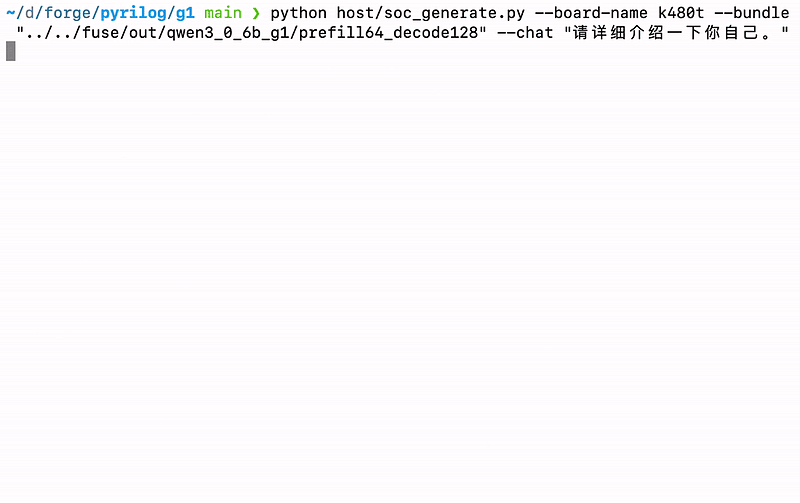
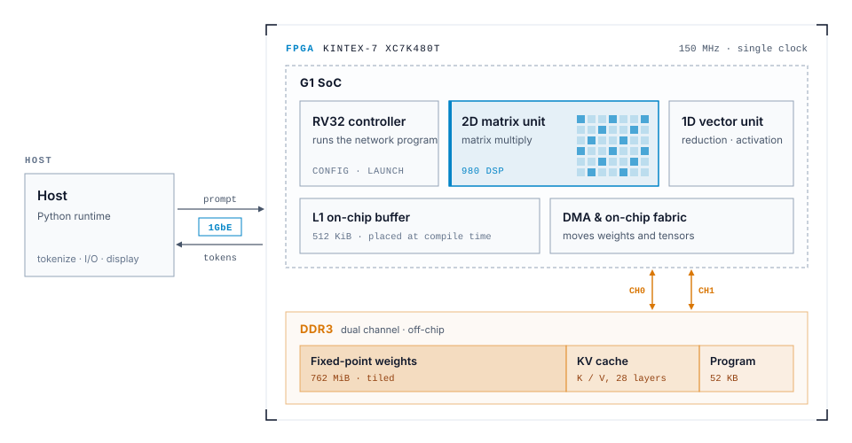

<div align="center">

<h1>GMP</h1>

<p><strong>AI designing the chips that run AI</strong></p>

<p>AI-native chip development toward Architecture 2.0 · Full stack from compiler to RTL built by AI agents · First milestone G1 runs Qwen3-0.6B on an FPGA</p>

<p><a href="README.md">中文</a> · <a href="#vision">Vision</a> · <a href="#milestone-g1">Milestone G1</a> · <a href="#ai-native-methodology">Methodology</a> · <a href="#quick-start">Quick start</a> · <a href="docs/bitstream.md">Measurements</a></p>

</div>

<p align="center">
  
</p>
<p align="center"><a href="docs/usage.md">On-board transcript</a> · <a href="docs/bitstream.md">Timing and resources</a> · <a href="demo/board_front_back.jpg">Board photos</a></p>

<div align="center">

<sub>First milestone · G1</sub>

| **28 / 28** layers | **21.38** token/s | **1** month | **541** commits | **0** lines |
| :-: | :-: | :-: | :-: | :-: |
| executed on the FPGA | decode, measured on board | hardware/software development | across three repositories | of human-written code |

</div>

## Vision

Traditional computer architecture design (Architecture 1.0) rests on architects' intuition, heuristics and piecemeal automation scripts.
**Architecture 2.0** is a fundamental paradigm shift: large language models and AI agents become the designers,
using AI to design the machines, systems and chips that run AI.

Its moonshot is a fully automated, closed-loop design system. Given a compact, high-level request, the system expands it on its own
through workload analysis, software compilation, microarchitecture definition, RTL generation and verification, all the way to
physical signoff, and delivers a physically verified, manufacturable chip design.

**GMP is an engineering effort toward that goal.** Humans own only the top-level architecture, system abstractions and key decisions;
AI agents take part in design at every layer and carry out all of the coding and verification. The compiler, model and hardware
evolve together, with whole-network inference as the final judge of correctness and performance.

GMP advances through staged milestones. Each chip generation is both a working result and a test of how far AI-driven design can go.
Human involvement narrows with every generation, while the design flow extends further toward the request on one end and signoff
on the other, until the full loop from requirement to manufacturable chip is closed.

<sub>The Architecture 2.0 ideas come from Vijay Janapa Reddi's book [*Architecture 2.0: Principles of AI-Native System and Chip Design*](https://arch2.mlsysbook.ai/).</sub>

## Milestone G1

G1 is GMP's first milestone. It demonstrates that, given an architectural direction from humans, AI agents can carry a design
through model compilation, cycle-accurate modeling, RTL implementation and on-board bring-up, delivering an inference chip prototype
that runs a real large language model.

### Architecture

G1 is an SoC built for on-device LLM inference, deployed on a single Kintex-7 FPGA (`xc7k480t`) with model weights resident
in on-board dual-channel DDR3. The compiler turns the whole network into one program, executed by an on-chip RV32 controller
that drives the matrix and vector units; the host communicates with the chip over 1GbE.



**Schedules fixed at compile time.** On-chip buffer capacity and the latency of every compute instruction are fully visible
to the compiler, which fixes the schedule ahead of time. The program image for whole-network prefill and decode totals just **52 KB**.

**Bandwidth-aware memory access.** The compiler tiles the weight layout and orders accesses around DRAM row structure,
cutting the bytes read per decode step **from 1,114 MB to 662 MB**, a reduction of about 41%.

### FPGA prototype

The current release runs Qwen3-0.6B end to end on a single Kintex-7: all 28 layers of prefill and autoregressive decode
execute on the FPGA, while the host handles only tokenization, data transfer and output display.

| Metric | Result |
| - | - |
| Context length | 1024 tokens |
| Clock frequency | 150 MHz, single clock domain across the SoC, timing closed |
| Decode throughput | 21.38 token/s, measured on the board |
| 64-token prefill time | 0.36 s, derived from cycle count and clock frequency |
| Resource utilization | LUT 75% · BRAM 72% · DSP 81% |

See the [measurement report](docs/bitstream.md) for hardware configuration, resource details and timing.

## AI-native methodology

General-purpose AI agents take a deep part in discussions of microarchitecture, pipeline partitioning and operator lowering, and carry
the full-stack development: model compiler, operator references, cycle-accurate C++ model, RTL, synthesis and place-and-route flow,
and host drivers. The CPU core, accelerator ISA and toolchain are developed in-house; FPGA integration uses DDR3 controllers,
clocking primitives and a third-party Ethernet MAC.

The G1 prototype took **one month** of hardware and software development across three repositories and **541 commits**.
The model compiler, cycle model, RTL and host drivers were written entirely by AI agents, **with not a single line written directly by a human**.

The methodology rests on three in-house pieces of infrastructure:

| Tool | Role | Design highlights |
| - | - | - |
| **Fuse** | Model compiler framework | Lowers model algorithms into instruction sequences the chip can execute |
| **Logix** | Cycle-accurate modeling framework | Simulates each hardware unit with C++ coroutines, running the whole network to validate designs and evaluate new hardware before RTL; exposes statistics as JSON for agents to analyze directly |
| **Pyrilog** | Python hardware description language | One Python class is one hardware module, sequential logic lives in a `cycle` method, clock and reset are wired automatically; generation is deterministic and reproducible, and checks signal references along the way |

In G1, 36k lines of Pyrilog generate 126k lines of Verilog across 278 modules.

**Closed-loop verification.** The compiler, cycle model and RTL share one set of reference data and are cross-checked automatically.
Design rationale is captured in layered documents, and writing and collaboration conventions are encoded as auto-loaded skills,
so every agent session builds on the same shared context.

## Quick start

**On the FPGA:** follow [setup](docs/setup.md) to prepare the board, a Linux host and the cables. Once dependencies and permissions
are configured, run:

```bash
python host/soc_generate.py --chat "请用一句话介绍一下你自己。"
```

The script checks the board, programs the bitstream and loads weights as needed, then starts generating text. The first run takes about a minute.
Programming uses the bundled pyjtag stack, so Vivado is not required. See the [usage guide](docs/usage.md) for the full workflow and troubleshooting.

**In simulation:** the prebuilt whole-SoC simulator runs on Linux x86-64 and needs Python 3.9+ and NumPy:

```bash
pip install numpy
python host/soc_generate.py --sim --chat "请用一句话介绍一下你自己。"
```

Simulation runs the chip RTL through Verilator with the same host program used on the board. It is substantially slower than the FPGA;
see the [simulation guide](docs/simulation.md) for memory and runtime requirements. The guides under `docs/` are in Chinese.

## Repository contents

* [Prebuilt artifacts](prebuilt/) and [model data](data/): bitstream, whole-SoC simulator, Qwen3-0.6B fixed-point weights, boot image and tokenizer vocabulary.
* [Inference SoC Verilog](src/soc/): SoC hardware generated from Pyrilog, ready for FPGA synthesis.
* [Host tools](host/) and [JTAG stack](tools/pyjtag/): source for inference control, Ethernet communication and bitstream programming.
* [Standalone RV32I_Zmmul core](src/rv32/): Pyrilog source, generated Verilog, tests, simulation environment and performance reports.

The model compiler, synthesis scripts, the inference SoC's Pyrilog source, and the complete Pyrilog and Logix framework sources are not yet open-sourced.
The prebuilt inference artifacts run Qwen3-0.6B only and cannot be used to compile other models.

## License

This repository uses the [MIT License](LICENSE). The Qwen3-0.6B vocabulary uses Apache-2.0; Xilinx cable firmware retains its original terms.
The Verilator 5.020 runtime linked into the prebuilt simulator is dual-licensed LGPL-3.0-only or Artistic-2.0.
CoreMark sources use the included [LICENSE.md](src/rv32/sw/coremark/src/LICENSE.md).
