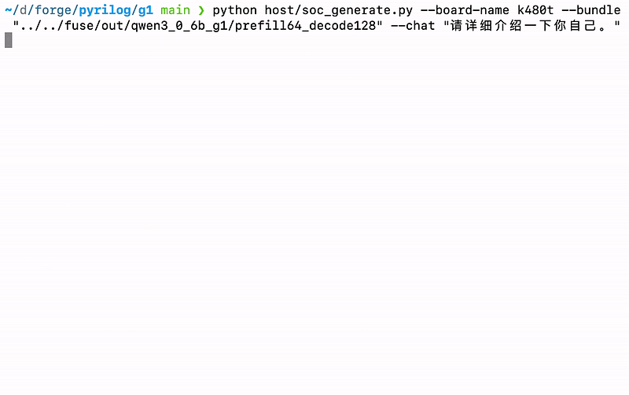
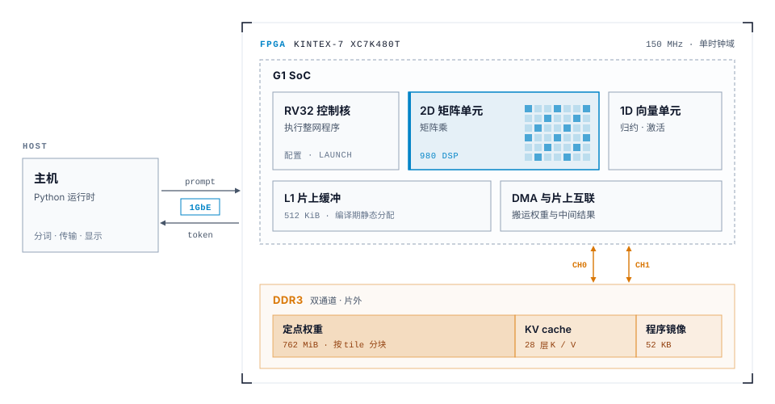

<div align="center">

<h1>GMP</h1>

<p><strong>用 AI 设计运行 AI 的芯片</strong></p>

<p>迈向 Architecture 2.0 的 AI Native 芯片研发 · 编译器到 RTL 全栈由 AI Agent 构建 · 首个里程碑 G1 已在 FPGA 上运行 Qwen3-0.6B</p>

<p><a href="README.en.md">English</a> · <a href="#愿景">愿景</a> · <a href="#里程碑-g1">里程碑 G1</a> · <a href="#ai-native-研发方法">研发方法</a> · <a href="#快速开始">快速开始</a> · <a href="docs/bitstream.md">性能与资源</a></p>

</div>

<p align="center">
  
</p>
<p align="center"><a href="docs/usage.md">板上运行记录</a> · <a href="docs/bitstream.md">性能与资源</a> · <a href="demo/board_front_back.jpg">板卡照片</a></p>

<div align="center">

<sub>首个里程碑 · G1</sub>

| **28 / 28** 层 | **21.38** token/s | **1** 个月 | **541** 次提交 | **0** 行 |
| :-: | :-: | :-: | :-: | :-: |
| 全部在 FPGA 上执行 | decode 板上实测 | 软硬件开发周期 | 横跨三个仓库 | 人工直接编写的代码 |

</div>

## 愿景

传统的体系结构设计（Architecture 1.0）建立在架构师的直觉、经验法则和零散的自动化脚本之上。
**Architecture 2.0** 是一次根本性的范式转变：以大语言模型和 AI Agent 为设计主体，用 AI 设计运行 AI 的机器、系统与芯片。

它的终极目标（Moonshot）是一个全自动的闭环设计系统：输入一句简洁的高层需求（Compact Request），
系统自行展开工作负载分析、软件编译、微架构定义、RTL 生成与验证，一路推进到物理签核（signoff），
最终交付经过物理验证、可直接制造的芯片方案。

**GMP 是朝这一目标迈出的工程实践。** 人类只负责顶层架构、系统抽象和关键决策；
AI Agent 参与每一层的设计，并完成全部编码与验证。编译器、模型与硬件协同迭代，始终以整网推理作为正确性与性能的最终裁判。

GMP 以分阶段的里程碑推进：每一代芯片既是一份可运行的成果，也是对 AI 设计能力边界的一次检验。
人类介入的范围逐代收窄，设计链路逐代向需求端和签核端延伸，直至实现从需求到可制造芯片的完整闭环。

<sub>Architecture 2.0 的理念出自 Vijay Janapa Reddi 的著作 [*Architecture 2.0: Principles of AI-Native System and Chip Design*](https://arch2.mlsysbook.ai/)。</sub>

## 里程碑 G1

G1 是 GMP 的第一个阶段性成果。它验证了一件事：在人类给定架构方向的前提下，AI Agent 能够贯通模型编译、
逐拍建模、RTL 实现到上板运行的全链路，交付一颗可以真实运行大模型的推理芯片原型。

### 架构

G1 是为端侧大模型推理定制的 SoC，部署在单片 Kintex-7 FPGA（`xc7k480t`）上，模型权重驻留于板载双通道 DDR3。
编译器把整个网络编译成一段程序，由片上 RV32 控制核执行，调度矩阵单元和向量单元完成计算；主机经千兆以太网与芯片通信。



**编译期确定调度。** 片上缓冲容量和每条计算指令的执行延迟对编译器完全可见，调度方案在编译期一次确定。
整网 prefill 与 decode 的程序镜像合计仅 **52 KB**。

**面向带宽的访存编排。** 编译器对权重分块布局，并按 DRAM 行结构编排访存，
将每步 decode 的实际读取量从 **1,114 MB 压缩至 662 MB**，减少约 41%。

### FPGA 原型

当前版本在单片 Kintex-7 上完整运行 Qwen3-0.6B：全部 28 层的 prefill 与自回归 decode 均在 FPGA 上执行，
主机只负责分词、数据传输和结果显示。

| 指标 | 结果 |
| - | - |
| 上下文长度 | 1024 个 token |
| 运行频率 | 150 MHz，整颗 SoC 单时钟域，时序收敛 |
| decode 速度 | 21.38 token/s（板上实测） |
| 64 个 token 的 prefill 耗时 | 0.36 秒（由运行周期数和时钟频率折算） |
| 资源占用 | LUT 75% · BRAM 72% · DSP 81% |

硬件配置、资源明细和时序结果见[性能与资源报告](docs/bitstream.md)。

## AI Native 研发方法

通用 AI Agent 深度参与微架构、流水线划分和算子实现方案的讨论，并承担从模型编译器、算子参考实现、C++ 逐拍模型、RTL、
综合与布局布线流程，到主机驱动的全栈开发。CPU 核、加速指令集与配套工具链均为自研；
FPGA 集成部分使用了 DDR3 控制器、时钟原语和第三方以太网 MAC。

G1 原型的软硬件开发历时**一个月**，横跨三个仓库，共 **541 次提交**。
模型编译器、逐拍模型、RTL 与主机驱动的代码全部由 AI Agent 编写，**没有一行由人直接编写**。

支撑这套方法的是三项自研基础设施：

| 工具 | 定位 | 设计要点 |
| - | - | - |
| **Fuse** | 模型编译框架 | 将模型算法降级为芯片可执行的指令序列 |
| **Logix** | 逐拍建模框架 | 以 C++ 协程模拟各硬件单元，在 RTL 之前跑通整网、验证设计、评估新硬件；统计结果以 JSON 输出，供 Agent 直接分析 |
| **Pyrilog** | Python 硬件描述语言 | 一个 Python 类即一个硬件模块，时序逻辑写在 `cycle` 方法中，时钟与复位自动连接；生成结果确定、可复现，并在生成时检查信号引用 |

在 G1 中，3.6 万行 Pyrilog 代码生成了 12.6 万行 Verilog，共 278 个模块。

**闭环验证。** 编译器、逐拍模型与 RTL 共享同一套参考数据，自动交叉比对。
设计依据沉淀为分层文档，写作与协作规范固化为自动加载的 skill，让每一次 Agent 会话都建立在同一份上下文之上。

## 快速开始

**在 FPGA 上运行**：按照[环境搭建](docs/setup.md)准备板卡、Linux 主机和连接线缆，安装依赖并配置权限，然后执行：

```bash
python host/soc_generate.py --chat "请用一句话介绍一下你自己。"
```

脚本会自动检查板卡状态，按需烧录 bitstream、加载权重，随后开始生成文本，首次运行约需一分钟。
烧录由仓库内置的 pyjtag 完成，无需安装 Vivado。使用方法和故障排查见[使用指南](docs/usage.md)。

**在仿真中运行**：预编译的整机仿真程序支持 Linux x86-64，需要 Python 3.9+ 和 NumPy：

```bash
pip install numpy
python host/soc_generate.py --sim --chat "请用一句话介绍一下你自己。"
```

整机仿真通过 Verilator 运行芯片 RTL，主机程序与上板时完全相同。仿真速度明显低于 FPGA，内存和运行要求见[仿真指南](docs/simulation.md)。

## 仓库内容

* [预编译文件](prebuilt/)和[模型数据](data/)：bitstream、整机仿真程序、Qwen3-0.6B 定点权重、启动镜像和分词词表。
* [推理 SoC 的 Verilog](src/soc/)：由 Pyrilog 生成、用于 FPGA 综合的 SoC 硬件代码。
* [主机程序](host/)和 [JTAG 烧录工具](tools/pyjtag/)：推理控制、以太网通信和 bitstream 烧录的源码。
* [独立的 RV32I_Zmmul 处理器核](src/rv32/)：Pyrilog 源码、生成的 Verilog、测试程序、仿真环境和性能报告。

模型编译器、综合脚本、推理 SoC 的 Pyrilog 源码，以及 Pyrilog 和 Logix 框架的完整源码暂未开源。
预编译的推理文件仅用于运行 Qwen3-0.6B，不能用来重新编译其他模型。

## 许可证

本仓库采用 [MIT License](LICENSE)。Qwen3-0.6B 词表遵循 Apache-2.0，随 Xilinx 线缆分发的固件保留原有授权。
预编译仿真程序链接了 Verilator 5.020 运行时，该运行时采用 LGPL-3.0-only 或 Artistic-2.0 双重许可。
CoreMark 源码的许可证见其目录内的 [LICENSE.md](src/rv32/sw/coremark/src/LICENSE.md)。
