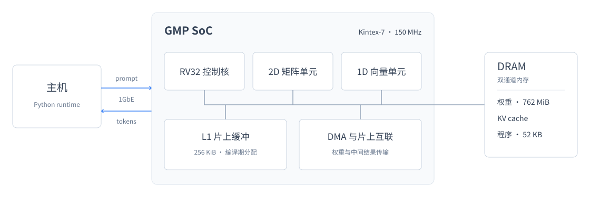

<div align="center">

<h1>GMP</h1>
<p><strong>AI Agent 构建的端到端大模型推理芯片</strong></p>
<p>单片 Kintex-7 FPGA · Qwen3-0.6B · 完整 28 层推理</p>

<p>
  
  
  
</p>

<p><a href="README.en.md">English</a> · <a href="#g1架构">G1架构</a> · <a href="#快速开始">快速开始</a> · <a href="docs/bitstream.md">实测数据</a></p>

</div>

- **完整模型上板**：prefill 与自回归 decode 的全部 28 层计算由 FPGA 完成，主机承担分词、传输与结果展示。
- **Agent 实现全栈**：一个月、三个仓库、541 次提交，完成从模型编译器、逐拍模型到 RTL 与主机驱动的实现，人未直接编写代码。
- **Python 生成硬件**：3.6 万行 Pyrilog 生成 12.6 万行 Verilog，覆盖 278 个模块。

<p align="center">
  
</p>
<p align="center"><a href="docs/usage.md">实机运行记录</a> · <a href="docs/bitstream.md">时序与资源</a> · <a href="demo/board_front_back.jpg">板卡照片</a></p>

## G1架构

GMP 是面向端侧推理的自研神经网络加速 SoC，部署于 Kintex-7 `xc7k480t`，模型权重存于板载双通道 DDR3。
编译器将整个网络编译成程序，由片上 RV32 控制核、矩阵单元和向量单元执行，主机通过 1GbE 与芯片通信。



编译器与硬件共同设计，片上缓冲容量和指令延迟对编译器完全可见，调度在编译期确定。
整网 prefill 与 decode 的程序镜像合计 **52 KB**。权重按 tile 分块，访存围绕 DRAM 行结构组织，
每步 decode 的实际读取量从 **1,114 MB 降至 662 MB**。

当前配置支持 128 token 上下文。Decode 为板上实测，prefill 耗时按周期数与 150 MHz 折算。
硬件规格、资源与时序见[实测报告](docs/bitstream.md)。

## Agent 开发

人负责顶层架构、抽象定义和方案取舍，通用 AI Agent 参与微架构、流水线与算子下沉的讨论，并完成各层代码实现。
开发覆盖模型编译器、算子参考实现、逐拍 C++ 模型、RTL、综合与布局布线流程及主机驱动。
CPU 核、加速指令集与工具链为自研；FPGA 集成使用 DDR3 控制器、时钟原语及第三方以太网 MAC。

**Pyrilog** 用 Python 描述硬件，由确定性生成器产出 Verilog。一个类对应一个模块，时序逻辑写在 `cycle` 方法中，
时钟与复位自动接入。同一输入生成逐字节相同的 RTL，生成器同时检查非法信号引用。

**逐拍建模框架** 用 C++ 协程模拟芯片各单元，在 RTL 实现前运行整网、评估新硬件，并通过 JSON 输出统计供 Agent 分析。
编译器、逐拍模型与 RTL 共用参考数据和自动检查；设计意图由分层文档保存，写作与协作方式由固定 skill 约束。

## 快速开始

**FPGA**：按[环境搭建](docs/setup.md)准备指定板卡、Linux 主机、1GbE 直连与 JTAG 线缆，完成依赖和权限配置后运行：

```bash
python host/soc_generate.py --chat "请用一句话介绍一下你自己。"
```

脚本按需烧录 bitstream、加载权重并开始生成，首次运行约一分钟。烧录使用仓库内的 pyjtag，无需 Vivado。
详细流程与排障见[使用指南](docs/usage.md)。

**整机仿真**：Linux x86-64 主机准备 Python 3.9 以上版本与 NumPy，使用预编译的 Verilator 仿真：

```bash
pip install numpy
python host/soc_generate.py --sim --chat "请用一句话介绍一下你自己。"
```

仿真执行整机 RTL，速度显著慢于板上运行，内存与运行要求见[仿真指南](docs/simulation.md)。

仓库提供以下产物与源码：

- [推理产物](prebuilt/)与[模型数据](data/)：bitstream、整机仿真、Qwen3-0.6B 定点权重、启动镜像与分词词表。
- [主机工具](host/)与 [JTAG 栈](tools/pyjtag/)：推理运行时、以太网通信及烧录工具源码。
- [独立 RV32I_Zmmul 核](src/rv32/)：Pyrilog、生成的 Verilog、测试程序、仿真环境与性能报告。

推理 SoC 的完整 RTL、模型编译器和综合脚本，以及完整的 Pyrilog 与建模框架未发布。
现有推理产物用于运行已编译的 Qwen3-0.6B，无法据此重新生成推理 bitstream 或编译其他模型。

## 许可证

本仓库采用 [MIT License](LICENSE)。Qwen3-0.6B 词表采用 Apache-2.0；Xilinx 线缆固件保留其原有授权；
预编译仿真链接的 Verilator 5.020 运行时采用 LGPL-3.0-only 或 Artistic-2.0 双授权。
CoreMark 源码遵循其目录内的 [LICENSE.md](src/rv32/sw/coremark/src/LICENSE.md)。
